# Vanilla Tune-Up: Fixes & Tweaks

Small fixes and optional tweaks for vanilla RimWorld, collected in one mod.
[Steam Workshop page](https://steamcommunity.com/sharedfiles/filedetails/?id=3815774199)

This page has the full description of every part; the same text is shown in game under
*Options > Mod settings > Vanilla Tune-Up*.

## How it works

- Turn each part on or off in *Options > Mod settings > Vanilla Tune-Up* (restart to apply).
- Fixes are on by default. Tweaks marked *on by default* only change the interface or wait until you use them;
  other tweaks are off until you turn them on.
- If one part fails to load (for example after a game update), only that part is turned off.

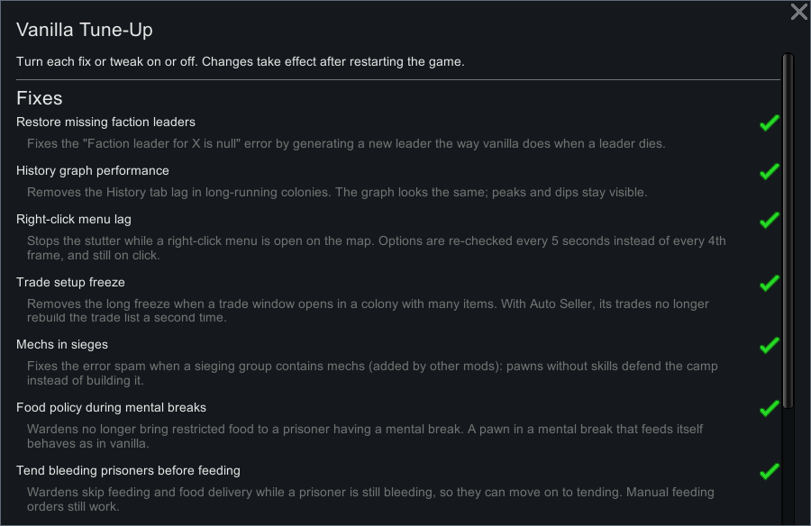

## Fixes

### Restore missing faction leaders

Fixes the "Faction leader for X is null" error by generating a new leader the way vanilla does when a leader dies.

### History graph performance

Removes the History tab lag in long-running colonies. The graph looks the same; peaks and dips stay visible.

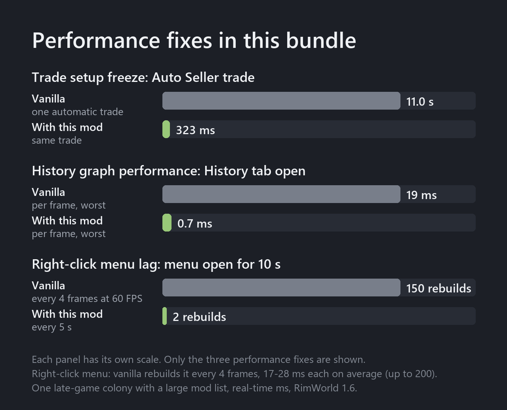

### Right-click menu lag

Stops the stutter when a right-click menu opens and while it is open on the map. Options are generated once on opening instead of three times, re-checked every 5 seconds instead of every 4th frame, and still on click.

### Trade setup freeze

Removes the long freeze when a trade window opens in a colony with many items. With Auto Seller, its trades no longer rebuild the trade list a second time.

### Mechs in sieges

Fixes the error spam when a sieging group contains mechs (added by other mods): pawns without skills defend the camp instead of building it.

### Food policy during mental breaks

Wardens no longer bring restricted food to a prisoner having a mental break. A pawn in a mental break that feeds itself behaves as in vanilla.

### Tend or operate on prisoners before feeding

Wardens skip feeding and food delivery while a prisoner is still bleeding or has surgery scheduled, so they can move on to tending or surgery. With only surgery pending, urgently hungry prisoners are still fed. Manual feeding orders still work.

### Prisoner food delivery keeps up

Wardens deliver food at the same hunger level as vanilla, but one trip brings enough for everyone in the cell who needs it by then, so food does not sit in the cell and spoil. Food already in the cell is counted, and only one warden delivers to a cell at a time, so wardens do not deliver twice. If a prisoner in the cell is already urgently hungry, more wardens may deliver at once to catch up, as many as the missing food needs full trips.

### Banished slaves free their bed

*Ideology*

A banished slave kept their slave bed after leaving, so other slaves skipped it as taken until you reassigned it by hand. The bed is now freed when a pawn stops being a slave, and beds left assigned this way in older saves are freed on load.

### Ejected genepacks stay out

*Biotech*

Genepacks ejected from a gene bank (eject all, the eject button on a single pack, or the right-click eject in the gene assembler) get their auto-load turned off, so haulers no longer carry them straight back into a gene bank. Turn auto-load back on for a pack to let it be stored again. Genepacks dropped because a gene bank was deconstructed, uninstalled or destroyed keep auto-load on, as in vanilla.

### Hungry pets find food across the map

A colony animal only looks for food within its nearest 100 regions, even when starving. In a large base full of doors and fences that is a small area, so a pet wandering far from the food stock could starve next to plenty of kibble. When an urgently hungry colony animal finds nothing nearby, it now searches the whole map once more (at most every 2500 ticks while nothing is found). Penned animals keep the vanilla search inside their pen.

### Farskip home unloads prisoners

*Royalty*

A caravan walking into your colony has everyone's cargo unloaded, prisoners included, but a farskip home only unloads colonists, pack animals and mechs. Prisoners carrying caravan goods kept them indefinitely. Farskipping home now marks prisoners (and rebellious slaves) for unloading too, so haulers take their cargo to storage like after a normal caravan arrival.

### Psychic ritual invoker keeps the offering

*Anomaly*

An invoker who vomited during a psychic ritual (gut worms, food poisoning, ...) dropped the offering, so the ritual failed for a missing offering. Vomiting no longer makes ritual participants drop what they carry. Also, when a psychic ritual is canceled, its participants stop standing at the ritual spot instead of staring there until drafted.

### Aligned corner icons

The bottom-right search and codex buttons no longer push the other toggle icons off the grid. Left to Unaligned Icon Fix when that mod is active.

### Official translation fixes

Fixes mistakes in the official translations that a translation file cannot override (currently Traditional Chinese): quest text shown as "ERR:" with raw [tags] for mech cluster outposts, and generated text left in English (pilgrims quest, trial accusations, ideoligion stories, art descriptions), plus a duplicate "X and X no longer fighting" message after social fights.

## Tweaks

### Xenogerm queue

*Biotech*

Adds a bill-style queue to the gene assembler: do X times, until you have X, or forever. Skipping an entry keeps its progress.

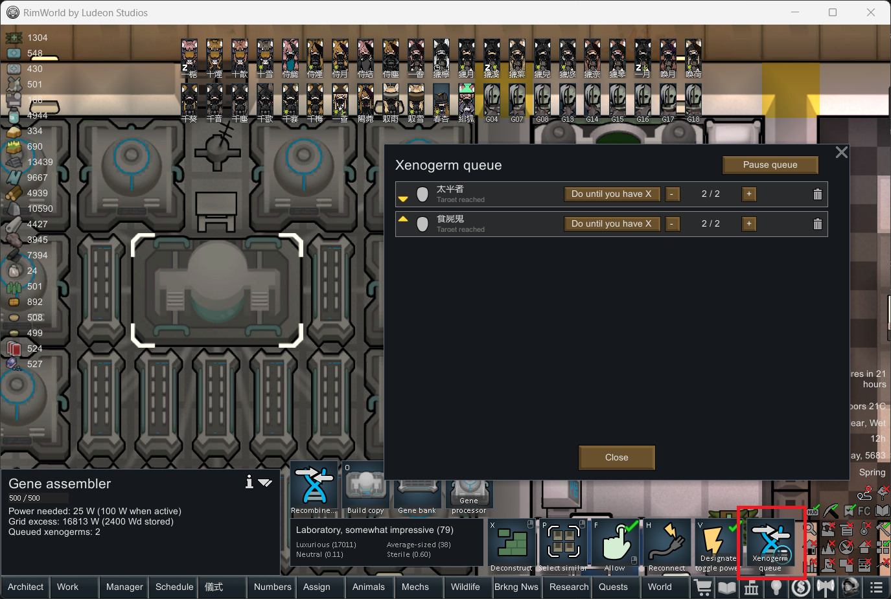

### Mute labor and birth sounds

*Biotech*

Mutes the labor (early/late) and birth sounds. Other baby sounds are unchanged.

### Remove fog of war

Reveals the whole map when it is generated or loaded. Fogged areas where revealing would set something off (sleeping enemies such as ancient dangers, quest or reveal signals, entity codex or hidden item discoveries) keep their fog and play as in vanilla; the rest of the map is still revealed. Rock, ore and collapsed rocks stay hidden until they are reached by mining, and pocket maps such as the labyrinth are never revealed.

### Faction icons in caravan lists

*on by default*

The form caravan, reform caravan and transport pod loading lists show the faction icon of every pawn that is not from your faction, such as guests and prisoners. Hover it for the faction name, click it for the faction info card.

### Caravan encounters stay on the current map

*on by default*

When an event happens to a caravan, such as meeting another caravan, a demand from a hostile one, or a mod event like finding ruins (Real Ruins), its dialog opens without switching from the colony map to the world map. Choosing to enter the encounter map still takes you there.

### Pin resources in the resource list

*on by default*

In the categorized resource list (top left), double-click a resource to pin it. Pinned resources stay listed while their category is collapsed and are shown even when you have none. Double-click again to unpin. Pins apply to every save.

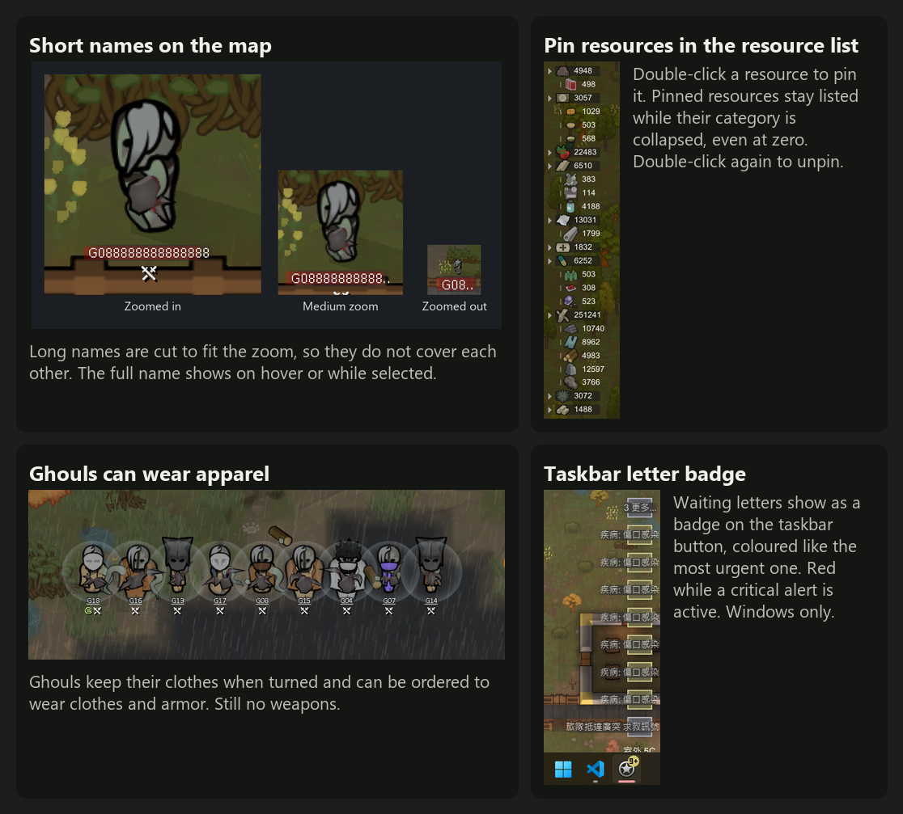

### Nutrient paste stock

*on by default*

Adds a "dispense until you have X" target to nutrient paste dispensers, like a cooking bill. The number is shared by every dispenser on the map. Cooks dispense paste and drop it by the dispenser for haulers, like a bill set to drop on the floor. Paste on the ground counts toward the target as well as paste in storage, so it does not pile up before haulers arrive.

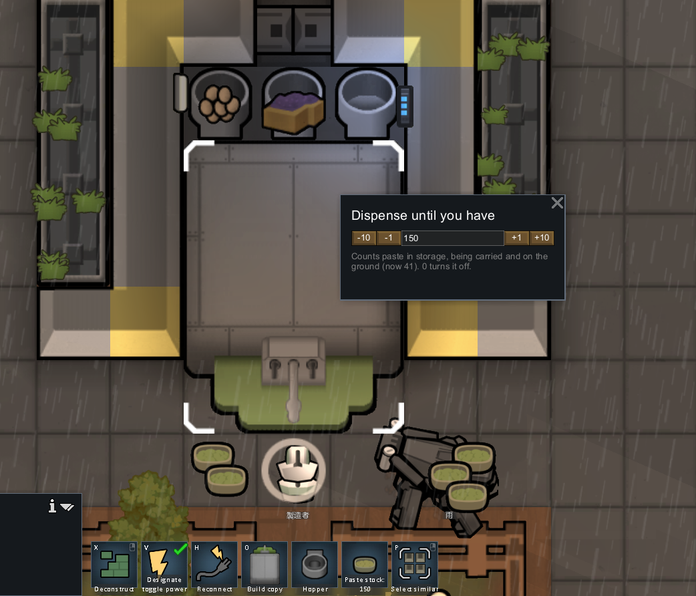

### Mod update notes

*Steam, on by default*

The main menu's top-left box (translation credits) becomes a list of your active Steam Workshop mods, most recently updated first. Mods updated since you last opened them are highlighted; click one to read its change notes from the Workshop. An update left unopened for 3 game starts stops being highlighted. Works for every mod. On the first run every mod counts as read.

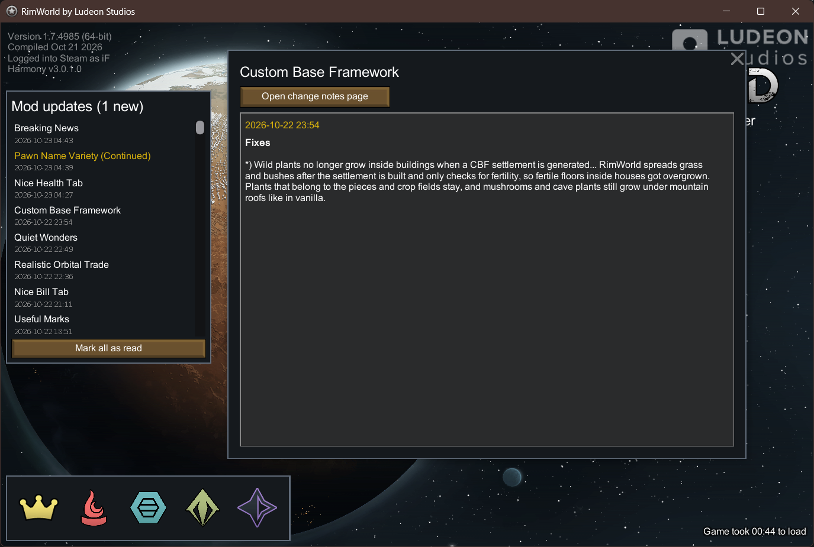

### Break up social fights

Anyone who sees a social fight nearby and is not hostile to either fighter (colonists, visitors, even raiders among themselves) may step in and try to stop it, unless they are busy with work that cannot be interrupted. A rival of either fighter, or anyone with Bloodlust, may instead join in against the fighter they like least. Success depends on their Social skill and on how much the fighters like them. When it fails, the fighter may turn on them, using the vanilla social fight formula, and the old opponent keeps going: a brawl that lasts until that fighter stops. Anyone hit by someone they are not fighting back may turn on them, so a brawl can split into several fights. Fighters remember who broke up their fight: most are grateful, but some resent it. Mood matters too: pawns in a bad mood insult others more often, start or join fights more readily, are harder to calm down and less willing to step in; a good mood works the other way (from x1.5 at 20% mood to x0.7 at 90%).

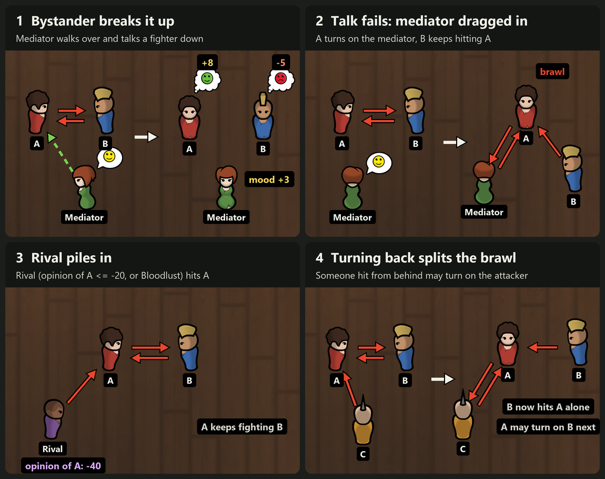

### Short names on the map

*on by default*

Names under pawns on the map are cut to about one and a half cells wide (following the zoom) so long names do not cover their neighbours. The full name shows while the mouse is over the pawn or its name, or while the pawn is selected.

### Ghouls can wear apparel

*Anomaly*

Ghouls keep their clothes when turned and can be ordered to wear clothes and armor (right-click the apparel with the ghoul selected). They never change clothes on their own and still cannot use weapons.

### Caravan: abandon all dead at once

*on by default*

Adds a button next to "Assign drug policies" on the caravan Items tab that abandons every human corpse and every tainted apparel (worn by someone who died) in the caravan inventory after one confirmation. Animal corpses are kept for butchering. Dead colonists are named in the confirmation. Apparel worn by living members is not touched.

### Taskbar letter badge

*Windows, on by default*

Shows the letters waiting on the right side of the screen as a small badge over the game's taskbar button: their number, coloured like the most urgent one (red for big threats, orange for small threats, and so on). Opening or dismissing letters updates it. While a critical (red) alert is active, such as a life-threatening condition or a colonist needing rescue, the badge turns red too, or shows a plain red dot when there are no letters. With no letters, a message on the top left shows a plain dot in the matching colour for as long as it stays on screen. While the game is paused the number becomes a pause sign (the colour stays), on a grey badge when there is nothing else to show. A glance at the taskbar tells you something happened while you were in another window. No pop-ups, sounds or flashing. Windows only.

### Right-click to dismiss bundled letters

*on by default*

When too many letters pile up, the oldest ones are folded into a single "N more..." letter that ignores right-click. Right-clicking it now dismisses all the letters inside at once, like right-clicking a normal letter. Letters that still wait for your choice (such as someone asking to join or visitors at the gate) cannot be dismissed with a right click and stay.

### Visitors take shelter from bad weather and enemies

Trader caravans and visitor groups wait just outside the colony and leave early as soon as any member, pack animals included, starts getting hypothermia or heatstroke. When the temperature at their spot gets close to the limit of the most sensitive member, or enemies of some strength are active on the map (a single hunted animal fighting back does not count), they move into a barn if they brought animals, otherwise a dining room, with a storeroom as the fallback for both. The room must be at a safe temperature and reachable by all of them. While sheltering they eat inside too: they sit at a table in the room or eat standing there, and only fetch food from outside the room once urgently hungry. Rain at their spot also sends them inside, quietly, and so does night (22:00 to 6:00) so they sleep indoors, though only in a barn or storeroom, never on a dining room floor. They go back outside once the enemies, the rain and the night are gone and the weather is mild again. Checked every few in-game minutes, also while they are still walking in (they then head straight for the room); a group that is already too cold or hot by then still leaves, and guards still fight enemies that come near.

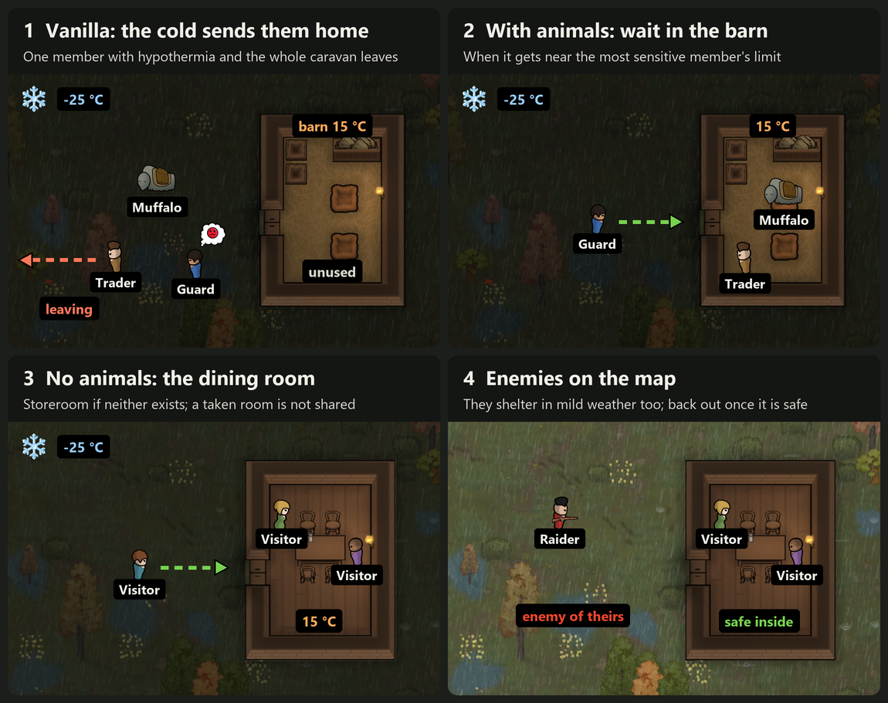

### Confirm before closing the game window

*on by default*

Closing the game window (the X button or Alt+F4) during a game quits at once. It now goes through the same steps as Quit to OS in the in-game menu: if there is unsaved progress you are asked to confirm first, and in commitment mode the game is saved before it quits. On the main menu the window still closes right away.

### Slaves use prisoner beds

*Ideology*

Slaves can sleep and recover in prisoner beds, medical ones included, so they can share the prison wing instead of needing their own bedrooms and hospital. Slaves do not claim a bed: each sleep takes any free one, so the bed of a slave at work or on night shift can take a new prisoner.

### Prisoners help out by personality

Kind prisoners tend cellmates lying in bed (always without medicine, so the quality is low; doctors still tend as usual) and feed bedridden cellmates a little before wardens would, from food or a nutrient paste dispenser in the cell. Hard-working, industrious or neurotic prisoners clean their cell when they have nothing else to do, unless they are also lazy. Only prisoners with these traits do it, and only inside their own cell.

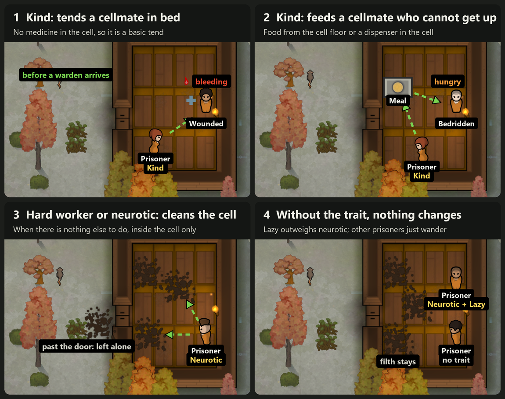

### Calmer prison breaks and slave rebellions

Escaping prisoners have no keys: they cannot open doors and have to break doors (or walls) to get out. Prisoners use the recreation buildings (television, chess table and so on) in the room of their own bed; slaves take recreation like colonists (except meditation), but not with buildings in prison cells. Recreation calms a prisoner the way a recent break does in vanilla (about a third less likely to break out, wearing off over 5 days), so prisoners play every couple of days; in recreation hours it raises a slave's suppression (about 10% per session). In other hours a slave slacks off on recreation now and then, more often the lower its suppression (about once in 6 days at 90%, 1.5 times a day at 70%, 8 times a day at 30%); slacking only keeps suppression from falling while it lasts, so wardens are still needed. Urgently hungry prisoners and slaves take no recreation. Instead of every prisoner in the cell, or every slave nearby, joining a break or rebellion, each one joins with a chance that drops the less inclined they are than the one who started it (recreation, a recent break, high suppression), and further with a good mood (prisoners), pain, or traits: Wimp, Nervous and Kind stay put more often, Bloodlust, Brawler and Volatile join more often, and so do malnourished prisoners and slaves while they are urgently hungry. The same mood, malnutrition, pain and traits also make each one start a break or rebellion less (or more) often; the prisoner tab tooltip lists them. Wardens arrest a prisoner walking off the map on its own (not one in a break, those fight back), and an undrafted colonist can be ordered to arrest a prisoner that got out of its cell; wardens also imprison a slave set to Imprison during a mental break that is not violent (vanilla waits it out); the arrest can still be resisted as in vanilla. Turrets shoot prisoners in a break, inside the cell too (vanilla turrets skip all prisoners).

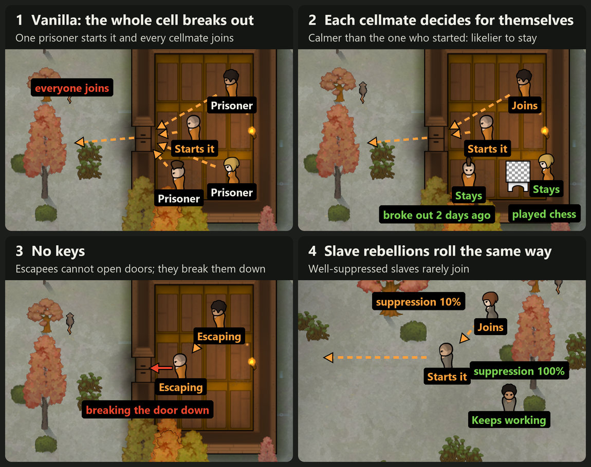

### Hide slaves from the colonist bar

*Ideology*

Slaves no longer get a portrait on the colonist bar, on maps or in caravans. Alerts such as low suppression or a slave rebellion still show and jump to them.

### Practice on trees for recreation

Pawns with a passion for Shooting or Melee can pass their recreation time practicing on a tree outside the home area and growing zones: shooting at it from a few cells away with a gun, or hitting it with a melee weapon (not with a gun or bare hands). Any tree will do, living or dead: practice never damages its target, so even strong weapons keep practicing on the same one. It counts as dexterity recreation, like horseshoes, so it helps most on maps away from the colony where nothing but meditative recreation is around. Stray shots never hit anyone; practice with a gun only happens with plain guns (no explosives, fire or single-use launchers) and only where no buildings or items (other than chunks) are within 4 cells of the tree. Special trees such as the anima tree or Gauranlen trees are left alone. Brawlers only practice with a melee weapon. Psychopaths and bloodlust pawns look for the corpses of enemies and animals first (never colonists), and shoot without caring what stray shots hit.

### Background music button

*on by default*

Adds a music note button to the row of toggle icons in the bottom-right corner (map and world view) that turns the background music off and on. It only silences the game's music player: the music volume in the options stays as it is, and the music is back on after the game restarts. Scrolling the mouse wheel over the button changes that music volume in 5% steps (down to 5%; use the button for silence); while muted the wheel zooms the camera as usual. The button is hidden while that volume is 0, since there is no music to turn off. A key can be bound to it in Options > Keyboard (Game section); none is set by default. Music that other mods play on their own is not affected.

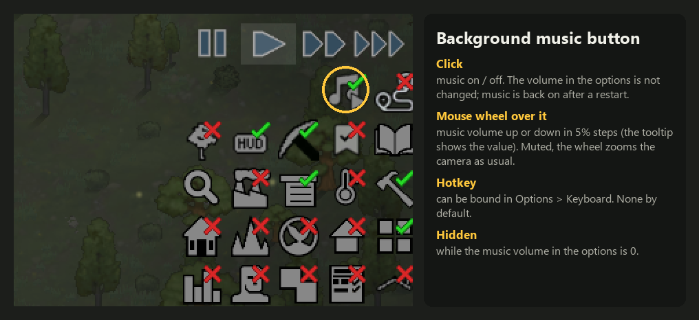

### Cycle keys for prisoners, visitors, animals and mechs

With an enemy, prisoner, visitor, colony animal, colony mech or wild animal selected, the next/previous colonist keys (default , and .) cycle through the others of the same kind on the current map instead of jumping to a colonist. Downed enemies count as enemies; pawns under fog are skipped. Slaves get their own cycle while "Hide slaves from the colonist bar" is on. With a colonist or nothing selected the keys work as usual. In every cycle, colonists included, a quiet tick plays when the keys come back to the pawn you started from.

### Camera follows the pawn it jumped to

*on by default*

After the camera jumps to a pawn and selects it (the next/previous colonist keys, double-clicking a portrait on the colonist bar, alerts such as a pawn needing rescue or a mental break, letters, messages, the quest window), it keeps following that pawn as it moves. Following stops when you move the camera yourself (keys, dragging, screen edge), select something else or clear the selection, or the pawn leaves the map. Zooming does not stop it.

### Psychic rituals: sort by psychic sensitivity

*Anomaly, on by default*

In the psychic ritual dialog, every portrait shows the pawn's psychic sensitivity in its top-left corner, and the "Not participating" list is sorted from the highest sensitivity to the lowest. Pawns already assigned to a role keep their order.

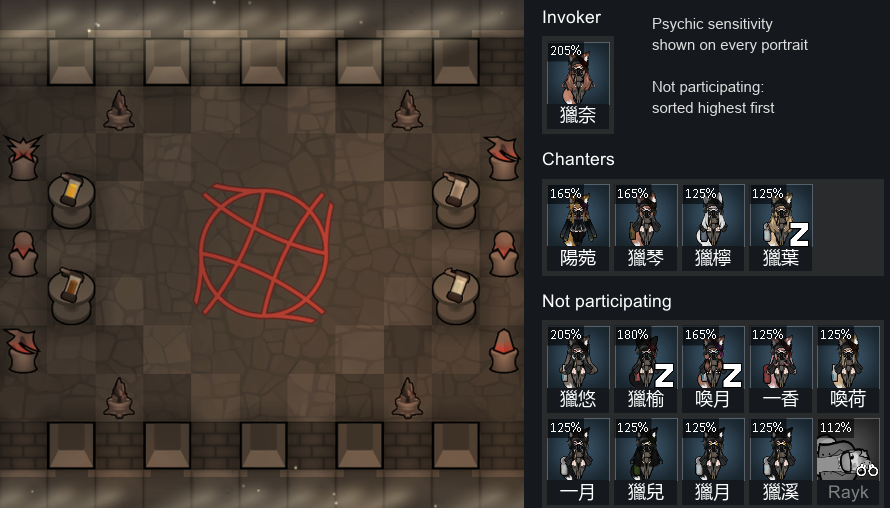

### Smelt and destroy bill improvements

*on by default*

For smelting, destroying and apparel-burning bills. Items that have no quality now count as legendary for the bill's quality filter, so a range like awful to normal no longer smelts them (vanilla lets them through any range). Adds a "Keep X of each" repeat mode: for every item type the bill allows, the X with the highest market value on the map (which weighs quality, hit points, tainted and biocoded) are left alone and only the rest are processed. Items worn or carried by pawns are not counted.

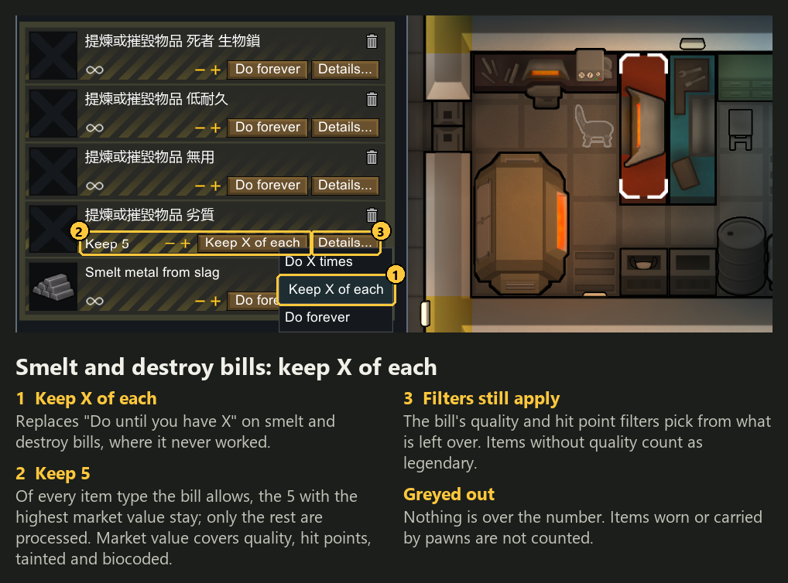

### Readers face the way their seat faces

*on by default*

A colonist reading on a chair, stool or other seat faces the way the seat faces. Vanilla turns them towards any table, dresser, end table, shelf or workbench next to the seat, even when that means sitting backwards. Only the look changes; reading works the same. Readers standing without a seat are unchanged.

### Camera jumps avoid the open inspect tab

*on by default*

Jumping the camera to a colonist (the next/previous colonist keys, double-clicking a portrait on the colonist bar, letters) puts it in the middle of the screen, where an open inspect tab (log, gear, social, character, needs, health) covers the left part. While such a tab is open, the colonist is now centred in the uncovered part of the screen to the right of the tab. Only the horizontal position changes.

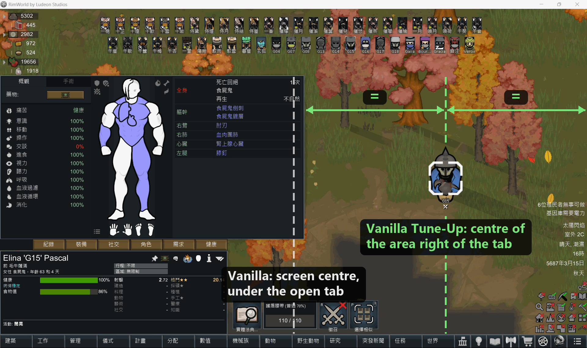

### Field tending and cheaper medicine

A bleeding colonist or prisoner outside a bed is tended where they are until the bleeding stops, then carried to a free bed for the rest. With no bed free, a downed one is tended where they lie for everything, and one on their feet or asleep on the ground for bleeding or a deadly disease. A downed patient who would bleed to death within 6 hours gets only medicine the doctor carries, or none, so nobody walks to a stockpile first. Better medicine only lowers a wound's infection chance and speeds its healing; it does not stop bleeding any better. So patients with no untended wound that can get infected and no disease that can kill get the cheapest medicine their medical care setting allows. Wounds that can get infected (cuts, bites, gunshots, burns, frostbite) and deadly diseases (infection, flu, plague, carcinoma and the like) still get the best, even between that disease's own tends.

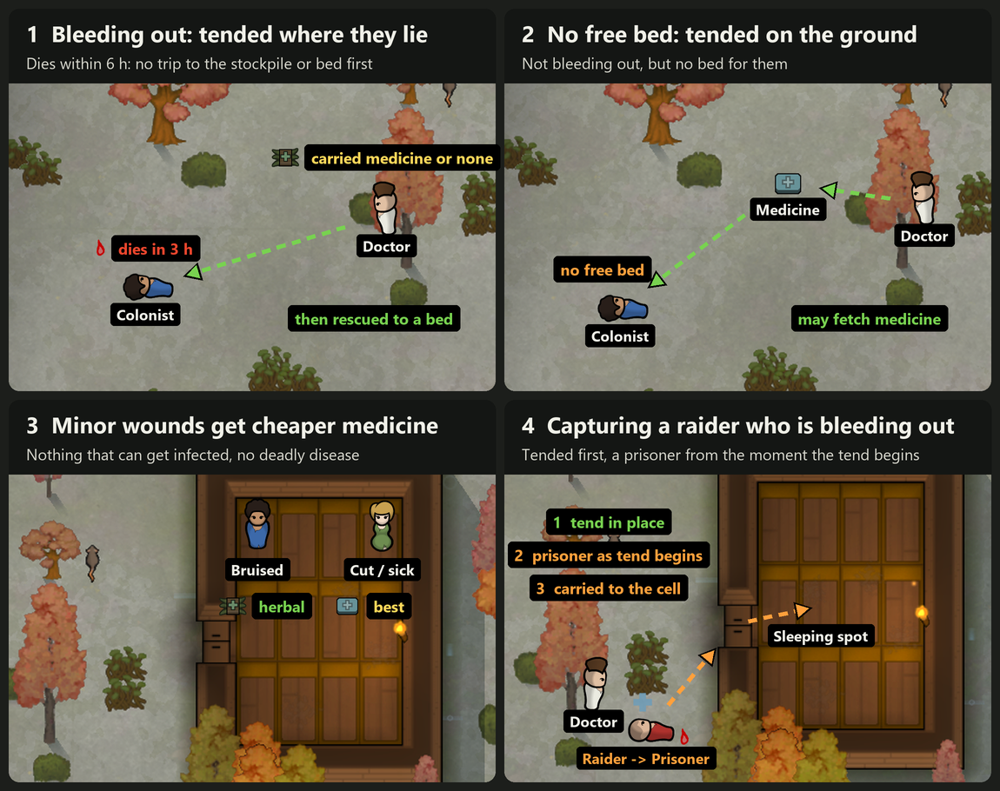

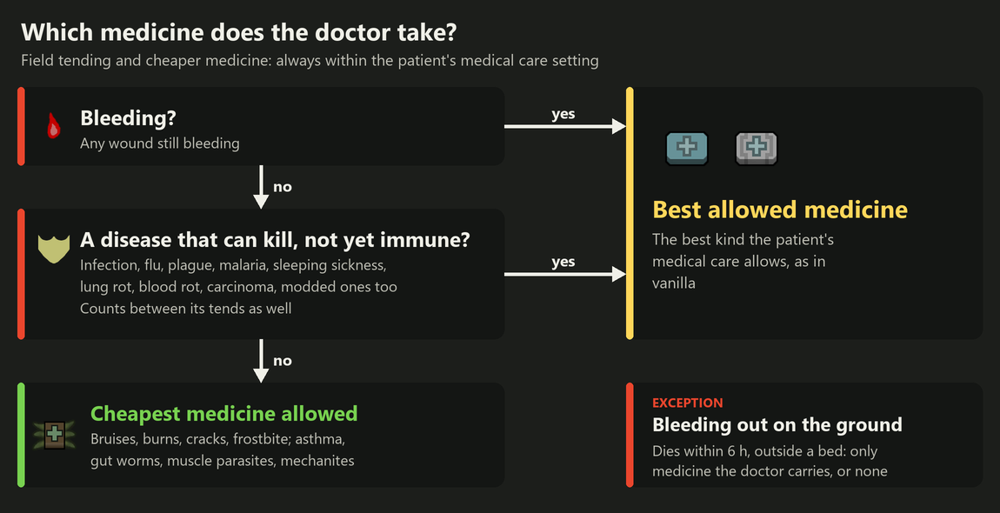

### Quicksave, save and quit, Continue

Press F5 during play to save right away, without opening the menu. Saves are named Quicksave-1, Quicksave-2 and so on; once all of them exist, the oldest one is overwritten, the same way autosaves rotate. Pressing again before any game time has passed (for example while paused) overwrites the same file instead. The key can be changed in Options > Keyboard (Game section). In commitment mode the game's single save file is used, like autosave. The "Really quit?" confirmation gets a "Save and quit" button that quicksaves first. The main menu gets a Continue button at the top that loads your newest save (autosaves and quicksaves included), with the usual version and mod list warnings; hover it to see which save it loads, or press Enter on the main menu to do the same (key changeable in Options > Keyboard).

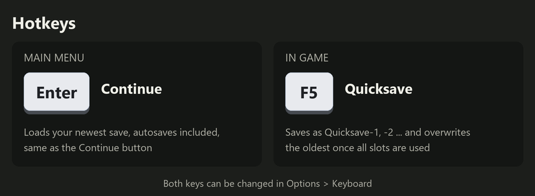

### Screensaver: follow random colonists when idle

*on by default*

When the game is running (not paused) and there has been no key press, mouse click or scroll for a while (moving the mouse and Alt or Windows key shortcuts such as Alt+Tab do not count, so you can switch to other windows freely), the interface is hidden like screenshot mode (F11) and the camera zooms in (a random amount per colonist) and follows a random awake colonist on the current map, switching to another one every so often. While it runs, the scroll wheel zooms and the next/previous colonist keys switch to another colonist as usual. Pressing any other key, clicking, or the game pausing (threat letters pause it) ends it, and the interface and selection go back to how they were; the camera stays where it is, or goes back too if you untick that option. The key or click that ends it then works as usual. A letter about an event or threat that does not pause the game switches to what it points at for one round, and so does a corner message about a threat (such as a social fight), a death, a health problem or an event (such as a trader arriving); each of the three can be switched off. The letters and corner messages stay on screen (can be turned off): letters can be opened or dismissed and messages clicked to jump to what they point at, without ending it; while an open letter pauses the game, the screensaver waits.

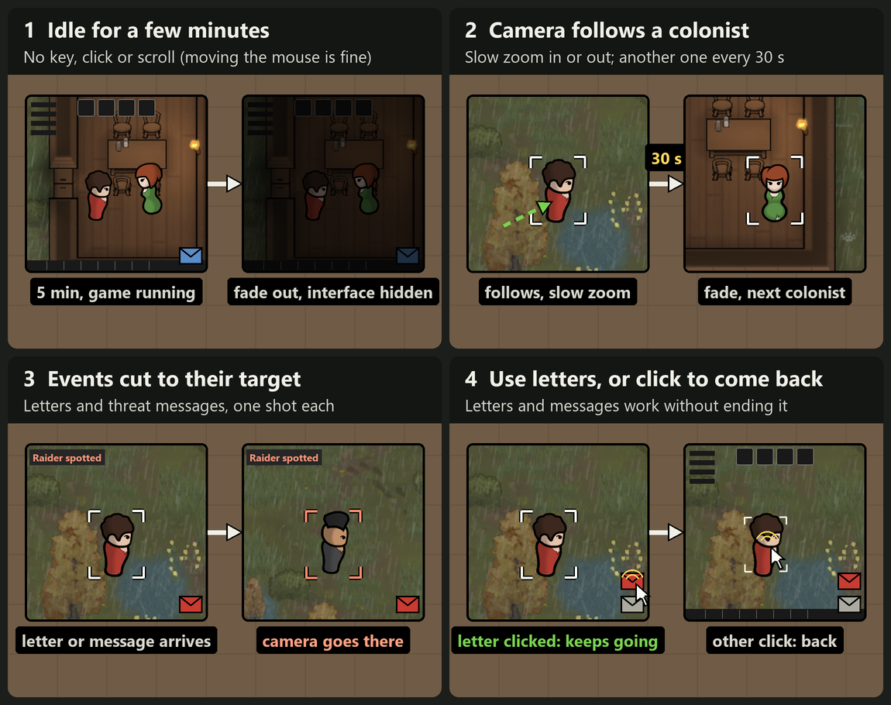

### Refugees change their clothes

*Royalty*

Refugees from the hospitality quest get an apparel policy in the Assign tab and replace worn-out clothes on their own, like colonists; arriving refugees can be given a policy of your choice. The clothes they arrived in stay on until they are tattered, and anything they put on leaves with them when the quest ends. Other quest lodgers, such as guards and royal guests, still keep their own outfit.

### Default policies for new prisoners and slaves

Pawns get the food policy chosen below when they become your prisoners or slaves, and new slaves also get the apparel policy chosen below (such as Ideology's own Slave policy, whose collars and straps slow suppression loss), so these no longer have to be set by hand each time. A pawn that stops being a prisoner or slave (recruited, released, enslaved, emancipated) while still on that policy goes back to the default policy. Prisoners get no apparel policy: they never dress by one in vanilla. Policies are matched by name, so use the same names in every save.

### Visitors leave colony food alone

Trader caravans, visitors and allied reinforcements, pack animals included, no longer eat food in your stockpiles or home area, or crops in growing zones and plant pots, while they carry any food of their own. Once their own food runs out and they get as hungry as the setting below, they may eat colony food again, limited to what the chosen food policy allows (animals ignore the policy). Wild food elsewhere on the map, grass included, stays open to them, so nobody starves next to your base.

### Guards for dangerous hunts

When a hunter goes after an animal with any revenge chance on harm (for that hunter, at shooting range), the nearest free colonists with a ranged weapon and hostility response set to attack come along as guards: they follow the hunter and shoot anything that attacks them. There is no upper limit on guards: more are sent for an animal with more health or one with packmates close by that would join its revenge (one guard per 3 health scale: a grizzly bear is 2.5, a megasloth 3.6, a thrumbo 8). The hunter waits at the shooting spot until every guard is close, for up to 30 seconds (strict mode below gives the hunt up instead). Guards are only picked from colonists who are not hungry, tired, hurt or busy with work that cannot be interrupted, and they go back to normal work once the animal is down and no packmate that joined its revenge is still near the hunter. Hunts you order by hand are left alone.

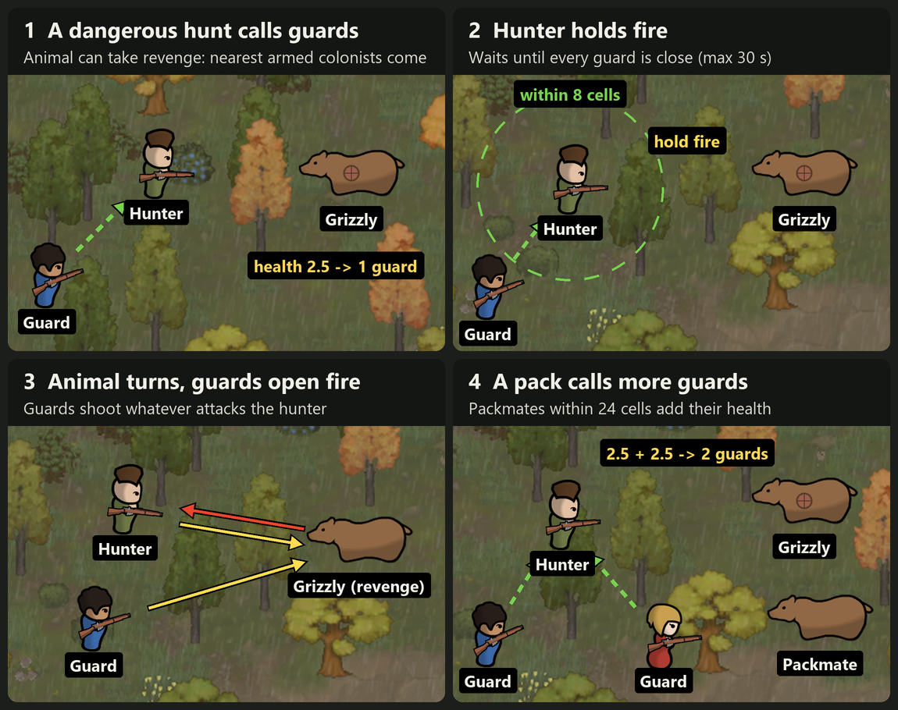

### Hybrid children keep a matching xenotype

*Biotech*

A child labeled Hybrid whose germline genes match one heritable xenotype by more than 80% (genes weighted by complexity, skin and hair color ignored) gets that xenotype instead; a tie is decided at random. Checked at birth and on every load; genes are not changed, and pawns with xenogenes are skipped unless the option below is on.

### Tell faction colors apart

On load, if any two factions with settlements on the world map have colors that look almost the same, the close colors are nudged apart, each moving only as far as needed and keeping its own color family as much as possible. Your own faction and the Empire keep their colors, and nothing changes when no colors are too close. The new colors are saved with the game.

### Drag to reorder

Hold the right mouse button and drag to reorder the bottom bar, the architect categories and the buildings inside them.

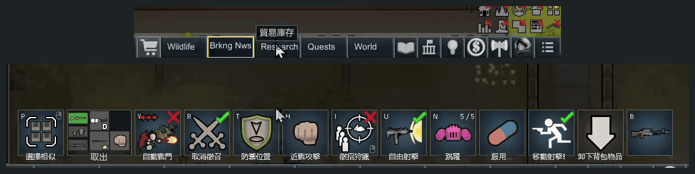

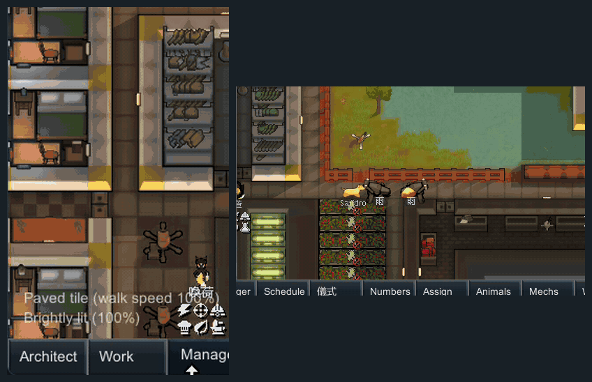

### Compact colonist bar

Colonist bar portraits shrink to two thirds of their height and the rows move closer together while the mouse is away and expand again when the mouse moves over the bar. Collapsed portraits show the head only.

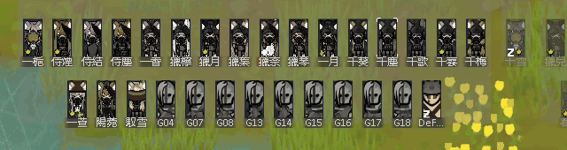

## Notes

- Safe to add to or remove from an existing save. Removing it only drops xenogerm queues; with Break up social
  fights on, the first load logs one harmless error per leftover fight memory.
- Load after Harmony. English and Traditional Chinese included.

---

This mod was developed with the help of AI coding tools (Claude Code). Full source code is in the
[Source](Source) folder for review.
